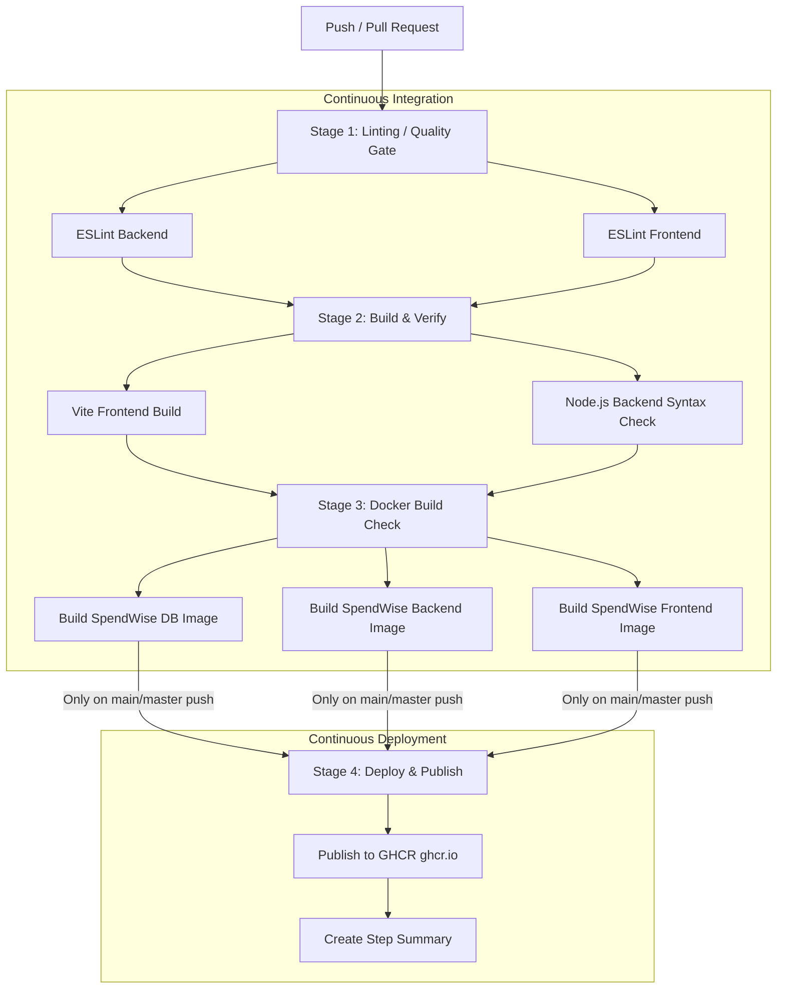

# 🚀 SpendWise CI/CD & Linter Documentation

Dokumentasi ini menjelaskan konfigurasi dan alur kerja **CI/CD (Continuous Integration / Continuous Deployment)** yang telah diimplementasikan pada repositori **SpendWise** menggunakan **ESLint** dan **GitHub Actions**.

---

## 📋 Daftar Isi
1. [Arsitektur CI/CD Pipeline](#1-arsitektur-cicd-pipeline)
2. [Linter Setup (ESLint Flat Config)](#2-linter-setup-eslint-flat-config)
   - [Frontend Linter (React + Vite)](#frontend-linter-react--vite)
   - [Backend Linter (Node.js + Express)](#backend-linter-nodejs--express)
3. [Perintah Menjalankan Linter Secara Lokal](#3-perintah-menjalankan-linter-secara-lokal)
4. [Tahapan Pipeline di GitHub Actions](#4-tahapan-pipeline-di-github-actions)
5. [Konfigurasi Workflow (`.github/workflows/ci-cd.yml`)](#5-konfigurasi-workflow)
6. [Best Practices untuk Anggota Tim](#6-best-practices-untuk-anggota-tim)

---

## 1. Arsitektur CI/CD Pipeline

Pipeline CI/CD ini dirancang dengan prinsip **Quality Gate** bertingkat untuk memastikan setiap kode yang masuk ke branch utama bebas dari error sintaks, pelanggaran gaya penulisan (*code smells*), dan siap dijalankan di container Docker.



---

## 2. Linter Setup (ESLint Flat Config)

ESLint dikonfigurasi menggunakan format standar terbaru (**ESLint 9 Flat Config**).

### Frontend Linter (React + Vite)
- **File Konfigurasi**: `frontend/eslint.config.js`
- **Plugin yang Digunakan**:
  - `@eslint/js`: Aturan rekomendasi dasar JavaScript.
  - `eslint-plugin-react`: Mendukung JSX dan deteksi otomatis versi React.
  - `eslint-plugin-react-hooks`: Memastikan aturan React Hooks ditaati.
  - `eslint-plugin-react-refresh`: Validasi Fast Refresh pada komponen Vite React.
  - `globals`: Menetapkan global variabel browser (`window`, `document`, dll).

### Backend Linter (Node.js + Express)
- **File Konfigurasi**: `backend/eslint.config.mjs`
- **Plugin yang Digunakan**:
  - `@eslint/js`: Aturan dasar JavaScript.
  - `globals`: Mendukung Node.js (`process`, `__dirname`, dll) dan CommonJS (`require`, `module.exports`).
  - Aturan toleransi parameter Express: `argsIgnorePattern: '^(_|next)'` agar middleware error handler `(err, req, res, next)` tidak memicu peringatan parameter tak terpakai.

---

## 3. Perintah Menjalankan Linter Secara Lokal

Sebelum melakukan `git commit` dan `git push`, anggota tim dapat menjalankan perintah berikut dari root repositori:

### Menjalankan Semua Linter Sekaligus (Root):
```bash
npm run lint
```
*(Menjalankan linting backend dan frontend secara berurutan)*

### Menjalankan Linter Per Layanan:
```bash
# Hanya Frontend
npm run lint:frontend
# atau langsung di folder frontend:
npm --prefix frontend run lint

# Hanya Backend
npm run lint:backend
# atau langsung di folder backend:
npm --prefix backend run lint
```

### Memeriksa Build Frontend Secara Lokal:
```bash
npm run build:frontend
# atau:
npm --prefix frontend run build
```

---

## 4. Tahapan Pipeline di GitHub Actions

File workflow berada di [`.github/workflows/ci-cd.yml`](file:///.github/workflows/ci-cd.yml) dan mencakup 4 tahapan utama:

| No | Tahap / Job | Deskripsi | Status Trigger |
|:--:|:------------|:----------|:---------------|
| **1** | **`lint`** | Menjalankan ESLint secara paralel untuk backend dan frontend menggunakan matrix strategy. | Otomatis pada `push` ke branch manapun (`main`, `feature/**`) & `pull_request`. |
| **2** | **`build-frontend` & `verify-backend`** | Memastikan bundle frontend sukses di-compile (`vite build`) dan file backend valid secara sintaks (`node --check`). Mengunggah artifact `frontend-dist`. | Dijalankan hanya jika tahap `lint` **LULUS**. |
| **3** | **`docker-build-check`** | Menguji proses build Docker image untuk `database`, `backend`, dan `frontend` menggunakan Docker Buildx. | Dijalankan hanya jika tahap `build` **LULUS**. |
| **4** | **`deploy`** | Menerbitkan container images ke **GitHub Container Registry (GHCR)** berlabel `:latest` dan commit SHA (`:${{ github.sha }}`). | Dijalankan hanya pada event **push ke branch `main`/`master`** setelah semua tahap CI lulus. |

---

## 5. Konfigurasi Workflow

Cuplikan konfigurasi utama pada `.github/workflows/ci-cd.yml`:

```yaml
name: SpendWise CI/CD Pipeline

on:
  push:
    branches: [ main, master, 'feature/**' ]
  pull_request:
    branches: [ main, master ]
  workflow_dispatch:

permissions:
  contents: read
  packages: write
```

### Mengapa Menggunakan GitHub Container Registry (GHCR)?
1. **Terintegrasi langsung**: Menggunakan autentikasi bawaan `${{ secrets.GITHUB_TOKEN }}`, tidak memerlukan token rahasia pihak ketiga.
2. **Keamanan & Traceability**: Setiap image terikat langsung dengan commit hash dan nama repositori `ghcr.io/michaelatj/spendwise/...`.
3. **Gratis untuk repositori publik dan edukasi**.

---

## 6. Best Practices untuk Anggota Tim

1. **Jalankan `npm run lint` sebelum push**:
   Membiasakan menjalankan linter di lokal menghindari *build failure* pada Pull Request di GitHub.
2. **Gunakan Pull Request (PR)**:
   Buat branch baru (contoh: `feature/nama-fitur`), lalu buka PR ke `main`. Pipeline CI akan otomatis menjalankan audit kualitas kode.
3. **Cek Tab Actions di GitHub**:
   Jika terdapat kegagalan pada pipeline, periksa log job yang bersangkutan untuk melihat file dan nomor baris yang melanggar aturan linter.
