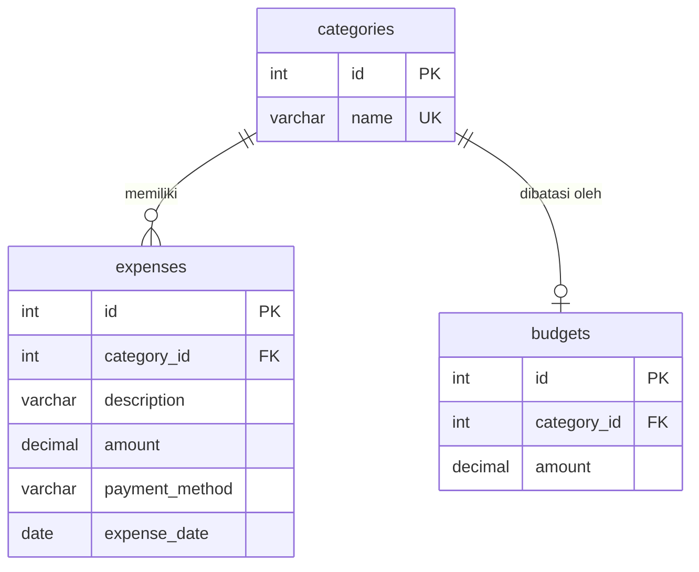

# SpendWise - Expense & Budget Tracker

SpendWise adalah aplikasi web pencatat pengeluaran dan anggaran pribadi yang berjalan sepenuhnya di dalam container Docker. Proyek ini dibuat untuk **Tugas Kelompok 1 (MID) - Pengembangan Aplikasi yang Berjalan pada Container**.

Seluruh aplikasi terdiri dari tiga container (frontend, backend, database) yang dijalankan bersama dengan satu perintah `docker compose up`.

## Daftar Isi

1. [Latar Belakang](#latar-belakang)
2. [Fitur](#fitur)
3. [Arsitektur Container](#arsitektur-container)
4. [Teknologi](#teknologi)
5. [Struktur Proyek](#struktur-proyek)
6. [Cara Menjalankan](#cara-menjalankan)
7. [Konfigurasi Environment](#konfigurasi-environment)
8. [Database](#database)
9. [Endpoint API](#endpoint-api)
10. [Pembagian Tugas](#pembagian-tugas)
11. [Tautan](#tautan)

## Latar Belakang

Banyak orang melakukan pembelian kecil setiap hari tanpa tahu ke mana uangnya pergi. Mencatat lewat catatan di ponsel atau spreadsheet cepat merepotkan ketika jumlah transaksi bertambah, dan hasilnya sulit dibaca sebagai gambaran pengeluaran secara keseluruhan.

SpendWise menggabungkan pencatatan pengeluaran, pengelolaan kategori, dan penetapan anggaran per kategori dalam satu aplikasi web sederhana. Versi pertama dibuat untuk satu pengguna (tanpa login), sehingga fokusnya ada pada fungsi inti dan pada penerapan container yang stabil.

## Fitur

| Menu | Fungsi |
|---|---|
| Dashboard | Menampilkan total pengeluaran, total anggaran, sisa anggaran, dan lima transaksi terbaru |
| Expenses | CRUD pengeluaran: deskripsi, nominal, kategori, metode pembayaran, tanggal |
| Categories | CRUD kategori pengeluaran |
| Budgets | CRUD anggaran, satu anggaran untuk setiap kategori |

Data disimpan di database MySQL, bukan di memori, sehingga tetap ada setelah container dihentikan dan dijalankan lagi.

## Arsitektur Container

```text
Browser
   |
   |  http://localhost  (port 80)
   v
+-----------------------------+
| spendwise-frontend          |
| Nginx + hasil build React   |
| melayani halaman statis,    |
| meneruskan /api ke backend  |
+--------------+--------------+
               |  http://backend:5000/api
               v
+-----------------------------+
| spendwise-backend           |
| Node.js 20 + Express        |
+--------------+--------------+
               |  database:3306 (SQL)
               v
+-----------------------------+
| spendwise-db                |
| MySQL 8.0                   |
| volume: db_data             |
+-----------------------------+

Ketiganya berada di satu network bawaan Compose: spendwise_default
```

Browser hanya berbicara dengan frontend. Frontend tidak pernah terhubung langsung ke database. Semua permintaan ke `/api` diteruskan oleh Nginx ke backend, dan hanya backend yang mengakses database.

### Container, image, dan port

| Container | Image (Docker Hub) | Port host:container | Fungsi |
|---|---|---|---|
| `spendwise-frontend` | `michaelandreastj/spendwise-frontend` | `80:80` | Antarmuka web dan reverse proxy `/api` |
| `spendwise-backend` | `michaelandreastj/spendwise-backend` | `5000:5000` | REST API |
| `spendwise-db` | `michaelandreastj/spendwise-db` | `3308:3306` | Database MySQL |

Catatan port database: di dalam container MySQL memakai port 3306, tetapi di komputer host dipetakan ke **3308** karena port 3306 sering sudah dipakai MySQL lokal atau XAMPP. Antar-container tetap memakai `database:3306` lewat network Docker, jadi pemetaan ini tidak memengaruhi backend. Port 3308 dan 5000 dibuka ke host hanya untuk keperluan pengujian (MySQL client dan Postman).

## Teknologi

| Bagian | Teknologi |
|---|---|
| Frontend | React 18, Vite, React Router, Tailwind CSS, Axios, Framer Motion, Lucide React |
| Web server | Nginx (Alpine) |
| Backend | Node.js 20 (Alpine), Express.js, mysql2, cors, dotenv |
| Database | MySQL 8.0 |
| Container | Docker, Docker Compose |
| Kontrol versi | Git, GitHub |

## Struktur Proyek

```text
SpendWise/
├── docker-compose.yml
├── .env.example
├── database/
│   ├── Dockerfile
│   └── init.sql
├── backend/
│   ├── Dockerfile
│   └── src/
│       ├── app.js
│       ├── server.js
│       ├── config/
│       ├── controllers/
│       ├── middlewares/
│       └── routes/
└── frontend/
    ├── Dockerfile
    ├── nginx.conf
    └── src/
        ├── api/
        ├── components/
        └── pages/
```

## Cara Menjalankan

### Prasyarat

- Docker Desktop (atau Docker Engine dengan Compose v2) yang sudah berjalan
- Port 80, 5000, dan 3308 di komputer tidak sedang dipakai aplikasi lain. Jika Apache XAMPP aktif, matikan dulu karena memakai port 80.

### Langkah

1. Clone repositori:

   ```bash
   git clone https://github.com/Michaelatj/SpendWise.git
   cd SpendWise
   ```

2. Salin file environment lalu isi nilainya:

   ```bash
   cp .env.example .env
   ```

   Di Windows PowerShell gunakan `Copy-Item .env.example .env`.

3. Bangun dan jalankan semua container:

   ```bash
   docker compose up --build
   ```

4. Setelah log menunjukkan backend berjalan, buka `http://localhost`.

5. Cek koneksi database lewat `http://localhost/api/health`.

### Menjalankan dari image Docker Hub (tanpa build)

```bash
docker compose pull
docker compose up -d --no-build
```

### Perintah yang berguna

| Perintah | Fungsi |
|---|---|
| `docker compose ps` | Melihat status container dan port |
| `docker compose logs -f backend` | Melihat log backend |
| `docker compose down` | Menghentikan container, data tetap tersimpan |
| `docker compose down -v` | Menghentikan container dan **menghapus data** (volume) |

## Konfigurasi Environment

Compose membaca file `.env` di folder yang sama dengan `docker-compose.yml`. File `.env` tidak boleh di-commit; yang di-commit hanya `.env.example`.

| Variabel | Fungsi |
|---|---|
| `DB_ROOT_PASSWORD` | Password root MySQL |
| `DB_NAME` | Nama database (`spendwise`) |
| `DB_USER` | User aplikasi (`spendwise_user`). Jangan diisi `root` |
| `DB_PASSWORD` | Password untuk user aplikasi |

Backend menerima kredensial ini sebagai environment variable dari Compose, dengan `DB_HOST=database` (nama service, bukan `localhost`).

## Database

Container database memakai image resmi `mysql:8.0`. `database/Dockerfile` hanya menyalin `init.sql` ke `/docker-entrypoint-initdb.d/`. Image resmi menjalankan isi folder itu **sekali saja**, yaitu saat volume `db_data` masih kosong. Pada saat itu juga database dan user dibuat dari variabel `MYSQL_*` di Compose.

Konsekuensinya: jika `init.sql` diubah, perubahan baru berlaku setelah `docker compose down -v` (volume dihapus) lalu `docker compose up --build`.

### Skema (ERD)



Satu kategori dapat memiliki banyak pengeluaran, dan paling banyak satu anggaran. Karena aplikasi ini untuk satu pengguna, tidak ada tabel `users`.

| Tabel | Kolom penting | Aturan |
|---|---|---|
| `categories` | `id`, `name` | `name` unik |
| `expenses` | `id`, `category_id`, `description`, `amount`, `payment_method`, `expense_date` | `amount` bertipe `DECIMAL(12,2)` dan harus lebih dari 0; index pada `category_id` dan `expense_date` |
| `budgets` | `id`, `category_id`, `amount` | `category_id` unik (satu anggaran per kategori); `amount` harus lebih dari 0 |

Kedua foreign key memakai `ON DELETE RESTRICT`: kategori yang masih dipakai pengeluaran atau anggaran tidak bisa dihapus. `init.sql` juga mengisi 8 kategori, 3 anggaran, dan 8 pengeluaran contoh.

### Masuk ke database

```bash
docker exec -it spendwise-db mysql -u spendwise_user -p spendwise
```

Dari komputer host (misalnya MySQL Workbench): host `127.0.0.1`, port `3308`, user dan password sesuai `.env`.

## Endpoint API

Semua endpoint berada di bawah `/api`.

| Resource | Method dan path |
|---|---|
| Health | `GET /api/health` |
| Dashboard | `GET /api/dashboard` |
| Expenses | `GET /api/expenses`, `GET /api/expenses/:id`, `POST /api/expenses`, `PUT /api/expenses/:id`, `DELETE /api/expenses/:id` |
| Categories | `GET /api/categories`, `GET /api/categories/:id`, `POST /api/categories`, `PUT /api/categories/:id`, `DELETE /api/categories/:id` |
| Budgets | `GET /api/budgets`, `POST /api/budgets`, `PUT /api/budgets/:id`, `DELETE /api/budgets/:id` |

## Pembagian Tugas

| Anggota | Tanggung jawab |
|---|---|
| Michael Andreas Tjendra | Database dan Docker: desain skema, `init.sql`, Docker Compose, container database, network, volume |
| Diky Diwa Suwanto | Frontend: antarmuka, dashboard, halaman Expenses, Categories, dan Budgets |
| Enjel Boyzest Saragih | Backend dan pengujian: REST API Express, validasi, penanganan error, pengujian API dan integrasi |

## Tautan

| Item | Tautan |
|---|---|
| Repositori GitHub | https://github.com/Michaelatj/SpendWise |
| Docker Hub - database | https://hub.docker.com/r/michaelandreastj/spendwise-db |
| Docker Hub - backend | https://hub.docker.com/r/michaelandreastj/spendwise-backend |
| Docker Hub - frontend | https://hub.docker.com/r/michaelandreastj/spendwise-frontend |
| Video dokumentasi | [ISI TAUTAN VIDEO] |
